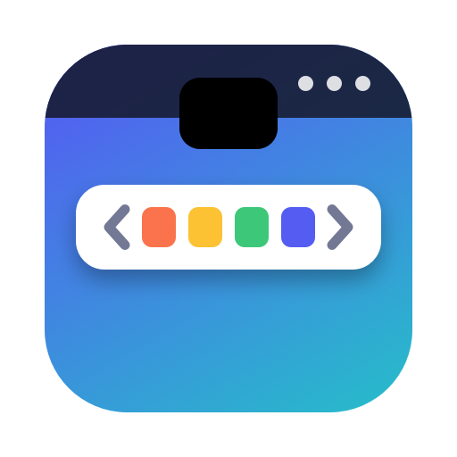

<p align="center">
  
</p>

<h1 align="center">Peeky</h1>

<p align="center">A macOS menu bar app that brings back the icons hidden behind the notch<br>Pick the ones you want, see them together, and flip through them with arrows — like the Windows taskbar overflow.</p>

<p align="center">
  <a href="https://github.com/eddieee-git/mac-app-peeky/releases/latest">Download the latest version</a> ·
  <a href="#install">Install</a> ·
  <a href="#shortcuts">Shortcuts</a> ·
  <a href="#faq">FAQ</a> ·
  <a href="CHANGELOG.en.md">Changelog</a> ·
  <a href="README.md">한국어</a>
</p>

## Features

- **Click hidden icons**: a bar drops down below the menu bar, and even icons hidden behind the notch open their real menus.
- **Flip through**: with many icons, use the **‹ ›** arrows, mouse wheel or trackpad, or ← → on the keyboard.
- **One, two or three rows**: spread the bar over several rows to scroll less.
- **Groups**: each group gets its own icon in the menu bar and shows only the items you put in it — e.g. "Work" and "System".
- **Real icon images**: with Screen Recording permission, items look exactly as they do in the menu bar (otherwise the app icon is shown).
- **Only what the notch hides**: optionally list just the items that are hidden right now.
- **In-app updates**: new versions are downloaded, signature-checked and swapped in.

The app's interface is in Korean.

## Install

1. Download `Peeky-x.y.z.dmg` from [Releases](https://github.com/eddieee-git/mac-app-peeky/releases/latest) and open it.
2. Drag **Peeky** into **Applications**.
3. Open Peeky. It has no Apple Developer signature, so macOS blocks the first launch. Click **Done**, then:
   - **macOS 15 (Sequoia) or later**: System Settings → Privacy & Security, scroll to the bottom, click **Open Anyway** next to Peeky, then **Open**.
   - **macOS 14 (Sonoma)**: right-click Peeky in Applications → **Open**.

   Or run `xattr -dr com.apple.quarantine /Applications/Peeky.app` in Terminal.
4. The settings window opens on first launch. Click **허용하기** (Allow) next to **손쉬운 사용** (Accessibility) and turn Peeky on in the list (required).
5. (Optional) **화면 기록** (Screen Recording) → turn Peeky on → **다시 열기** (Reopen) to show real icon images.

## Usage

1. Click the Peeky icon (`‹›`) in the menu bar or press **⌃⌥1**. The bar opens right below the menu bar.
2. Click an icon in the bar to open that app's menu. Right-click tries the secondary menu.
3. In settings, **항목별 그룹** (Group per item) picks which group each icon appears in. 「숨김」 (Hidden) shows it nowhere.
4. To add groups: settings → **그룹** (Groups) → **＋ 그룹 추가** (Add group). Each group can have its own name and symbol.

If the Peeky icon itself is hidden by the notch, ⌘-drag it to the right; the position is remembered. Shortcuts always work.

## Shortcuts

| Keys | Action |
|---|---|
| ⌃⌥1 – ⌃⌥9 | Toggle the bar for group 1–9 |
| ⌃⌥B | Toggle the first group's bar |
| ← → | (while the bar is open) scroll left/right |
| esc | Close the bar |

## Settings

| Setting | Description |
|---|---|
| Only items hidden by the notch | Shows only items currently under the notch or pushed off-screen |
| Rows | One / two / three |
| Max bar width | Beyond this width, use arrows and scrolling |
| Launch at login | Start automatically |
| Install new versions automatically | Checks GitHub once a day and installs new versions (on by default) |

## FAQ

**I turned the permission on but settings still shows orange.**
The Peeky entry in the list may belong to an older build. Remove it with − and click Allow again, or reset with `tccutil reset Accessibility com.eddieee.Peeky` (`ScreenCapture` for Screen Recording). Screen Recording takes effect after **Reopen**.

**What does it send?**
Only one request to GitHub's public API asking for the latest release when checking for updates. Menu bar items and screen contents are never sent anywhere. Turning off automatic updates stops that too.

**Does it work on Macs without a notch?**
Yes — it's still useful for grouping menu bar icons. "Only items hidden by the notch" only matters on a notched display.

## Uninstall

1. Right-click the Peeky icon → **Peeky 종료** (Quit)
2. Move Peeky from Applications to the Trash
3. (Optional) `defaults delete com.eddieee.Peeky` for settings, `tccutil reset All com.eddieee.Peeky` for permission records

## Build it yourself

Requires an Apple silicon Mac, macOS 14+, and the Xcode Command Line Tools (Xcode itself is not needed).

```bash
./scripts/make-signing-cert.sh   # (optional, once) local certificate so permissions survive rebuilds
./scripts/test.sh                # self-test
./scripts/build-app.sh           # build/Peeky.app + build/Peeky-<version>.dmg
open build/Peeky.app
```

When signing with that certificate, macOS must trust it for code signing before permissions are recognized:

```bash
security find-certificate -c "Peeky Local Signing" -p > /tmp/peeky.pem && security add-trusted-cert -r trustRoot -p codeSign -k ~/Library/Keychains/login.keychain-db /tmp/peeky.pem
```

## License

[MIT](LICENSE)
