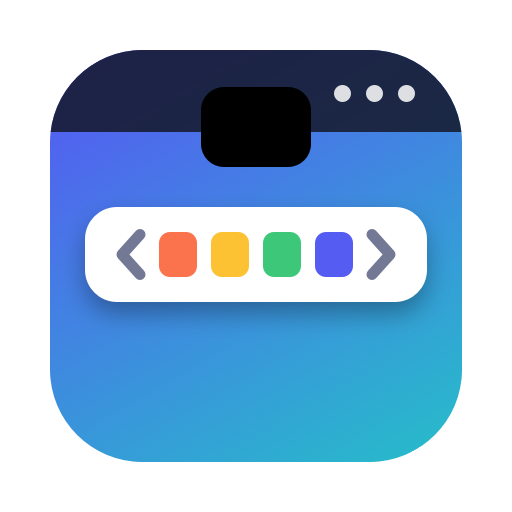

<p align="center">
  
</p>

<h1 align="center">Peeky</h1>

<p align="center">노치에 가려진 메뉴바 아이콘을 꺼내 보는 macOS 메뉴바 앱<br>Windows 작업 표시줄의 숨김 아이콘처럼, 골라서 모아 보고 화살표로 넘기세요.</p>

<p align="center">
  <a href="https://github.com/eddieee-git/mac-app-peeky/releases/latest">최신 버전 내려받기</a> ·
  <a href="#설치">설치</a> ·
  <a href="#단축키">단축키</a> ·
  <a href="#자주-묻는-질문">자주 묻는 질문</a> ·
  <a href="CHANGELOG.md">변경 기록</a> ·
  <a href="README.en.md">English</a>
</p>

## 특징

- **가려진 아이콘을 바로 클릭**: 메뉴바 아래로 바가 내려오고, 노치 뒤에 숨은 아이콘도 눌러서 원래 메뉴를 열 수 있어요.
- **넘겨 보기**: 아이콘이 많으면 **‹ ›** 화살표, 마우스 휠·트랙패드, 키보드 ← → 로 좌우로 넘겨요.
- **한 줄·두 줄·세 줄**: 바를 여러 줄로 펼쳐서 덜 넘기게 할 수 있어요.
- **그룹**: 그룹마다 메뉴바에 아이콘이 하나씩 생기고, 누르면 그 그룹에 넣은 항목만 보여요. 예: "업무"와 "시스템"을 따로. 줄 수와 표시 방식은 그룹마다 따로 정할 수 있어요.
- **메뉴바에서 진짜로 숨기기**: 구분선 왼쪽으로 옮긴 아이콘은 메뉴바에서 사라지고 Peeky 바에서만 보여요.
- **끌어서 순서 바꾸기**: 바 안의 아이콘을 끌어 원하는 순서로 놓아요.
- **노치에 마우스 올리기**: 켜 두면 노치에 마우스를 잠깐 올리는 것만으로 바가 열려요.
- **진짜 아이콘 모양**: 화면 기록 권한을 주면 메뉴바에 보이는 그대로의 아이콘을 보여 줘요(없으면 앱 아이콘).
- **노치에 가려진 것만 보기**: 지금 실제로 가려진 항목만 바에 띄울 수 있어요.
- **알아보기 쉬운 이름**: 배터리, Wi-Fi, 소리처럼 이름이 없던 macOS 기본 항목에도 이름을 붙여요.
- **앱 안 업데이트**: 새 버전이 나오면 알려 주고, 서명을 확인한 뒤 바꿔 넣어요.
- **한국어·영어**: 처음에는 Mac의 언어를 따르고, 설정에서 바꿀 수 있어요.

## 설치

1. [Releases](https://github.com/eddieee-git/mac-app-peeky/releases/latest)에서 `Peeky-x.y.z.dmg`를 내려받아 열어요.
2. **Peeky**를 **Applications** 폴더로 끌어다 놓아요.
3. Peeky를 열어요. Apple 개발자 서명이 없는 앱이라 처음 한 번은 열 수 없다는 경고가 나와요. **완료**를 누른 뒤:
   - **macOS 15(Sequoia) 이상**: 시스템 설정 → 개인정보 보호 및 보안을 맨 아래까지 내려서 Peeky 옆의 **그래도 열기**를 누르고, 한 번 더 **열기**를 눌러요.
   - **macOS 14(Sonoma)**: 응용 프로그램 폴더에서 Peeky를 **오른쪽 클릭 → 열기**를 눌러요.

   터미널이 편하면 `xattr -dr com.apple.quarantine /Applications/Peeky.app`을 실행해도 돼요.
4. 처음 실행하면 설정 창이 떠요. **손쉬운 사용** 옆 **허용하기**를 누르고 목록에서 Peeky를 켜요(필수).
5. (선택) **화면 기록** 옆 **허용하기** → 목록에서 Peeky 켜기 → **다시 열기**. 실제 아이콘 모양이 보여요.

## 쓰는 방법

1. 메뉴바의 Peeky 아이콘(`‹›`)을 누르거나 **⌃⌥1**을 눌러요. 메뉴바 바로 아래에 바가 열려요.
2. 바의 아이콘을 누르면 그 앱의 메뉴가 열려요. 오른쪽 클릭은 보조 메뉴를 시도해요.
3. 설정(⚙︎) → **기본 설정**의 **바에 보일 아이콘**에서 스위치를 켠 아이콘만 Peeky 바에 보여요. 아이콘 옆의 「노치 뒤」「숨겨 둠」「자리 없음」은 지금 메뉴바에서 안 보이는 이유예요.
4. 그룹을 더 만들려면 설정 → **고급** → **그룹** → **＋ 그룹 추가**. 그룹이 둘 이상이면 아이콘마다 스위치 대신 그룹을 골라요. 그룹마다 이름과 아이콘 모양을 바꾸고, **⋯**에서 줄 수와 표시 방식을 따로 정할 수 있어요.
5. 바 안의 아이콘을 끌면 순서가 바뀌어요. 설정 → 고급의 **순서 초기화**로 메뉴바 순서로 되돌려요.

### 메뉴바에서 숨기기

1. 설정 → **고급** → **메뉴바 정리** → **메뉴바에서 항목 숨기기**를 켜면 메뉴바에 구분선(╱)과 **›** 버튼이 생겨요. 처음에는 아무것도 숨기지 않아요.
2. ⌘를 누른 채 숨길 아이콘을 구분선 **왼쪽**으로 끌어다 놓아요. Peeky 아이콘은 구분선 **오른쪽**에 두세요.
3. 구분선 왼쪽 항목은 메뉴바에서 사라지고 Peeky 바에서만 보여요. 바에서 누르면 잠깐 펼쳐서 메뉴를 열고, 메뉴를 닫으면 다시 숨겨요.
4. 다 옮겼으면 **›** 버튼을 눌러 숨겨요. 숨긴 동안에는 **‹** 버튼으로 바뀌고, 누르면 다시 펼쳐요. Peeky 아이콘 오른쪽 클릭 메뉴로도 펼치거나 접을 수 있어요.
5. Peeky 아이콘이 구분선 왼쪽에 있으면 숨기지 않고 펼쳐 둔 채 알려 줘요.

Peeky 아이콘 자체가 노치에 가려지면 ⌘를 누른 채 오른쪽으로 끌어 옮기세요. 위치는 기억돼요. 가려져 있어도 단축키는 항상 동작해요.

## 단축키

| 키 | 동작 |
|---|---|
| ⌃⌥1 ~ ⌃⌥9 | 그룹 1~9의 바 열기/닫기 |
| ⌃⌥B | 첫 번째 그룹 바 열기/닫기 |
| ← → | (바가 열려 있을 때) 좌우로 넘기기 |
| esc | 바 닫기 |

보조 키(⌃⌥)는 설정 → **단축키**에서 ⌃⌘, ⌥⌘, ⌃⇧로 바꾸거나 끌 수 있어요.

## 설정

| 항목 | 설명 |
|---|---|
| 노치에 가려진 항목만 표시 | 지금 노치에 가려졌거나 화면 밖으로 밀려난 항목만 바에 보여요(그룹마다 바꿀 수 있음) |
| 줄 수 | 한 줄 / 두 줄 / 세 줄(그룹마다 바꿀 수 있음) |
| 노치에 마우스를 올리면 첫 그룹 바 열기 | 노치가 있는 화면에서만 동작(기본 끔) |
| 단축키 | ⌃⌥ / ⌃⌘ / ⌥⌘ / ⌃⇧ / 끔 |
| 메뉴바에서 항목 숨기기 | 구분선 왼쪽 항목을 메뉴바에서 숨김(기본 끔) |
| 바 최대 너비 | 이 너비를 넘으면 화살표와 스크롤로 넘겨요 |
| 로그인 시 실행 | Mac을 켤 때 자동으로 실행 |
| 언어 | 시스템 설정 따르기 / 한국어 / English. 바꾸면 Peeky를 다시 열어야 적용돼요 |
| 새 버전 자동으로 확인 | 하루 한 번 GitHub에서 새 버전을 확인해요(기본 켬) |
| 새 버전 자동으로 설치 | 확인한 새 버전을 Peeky를 쓰지 않을 때 알아서 설치하고 다시 켜요(기본 켬) |
| 진단 로그 남기기 | 권한 상태를 `~/Library/Logs/Peeky.log`에 기록(기본 끔, 끄면 파일 삭제) |

## 자주 묻는 질문

**메뉴바에 Peeky 아이콘이 안 보여요.**
노치에 가려졌거나 메뉴바에 자리가 없을 때 그래요. 응용 프로그램 폴더에서 Peeky를 한 번 더 열면 설정 창이 뜨고, 맨 위에 안내가 나와요. **⌃⌥1**로 바를 열 수 있고, ⌘를 누른 채 다른 아이콘을 왼쪽으로 옮겨 자리를 만든 뒤 Peeky 아이콘을 오른쪽 끝으로 옮기면 돼요. 설정 → 고급 → 메뉴바 정리의 **Peeky 아이콘을 오른쪽 끝으로 옮기기**를 누르면 처음 자리로 돌아와요. macOS 26에서는 시스템 설정 → 메뉴 막대에서 Peeky가 켜져 있는지도 확인하세요.

**권한을 켰는데 설정 창이 계속 주황색이에요.**
목록에 남은 Peeky가 예전 빌드의 항목일 수 있어요. 목록에서 Peeky를 −로 지우고 다시 **허용하기**를 누르세요. 설정 → 고급 → 문제 해결의 **진단 로그 남기기**를 켜면 Peeky가 권한을 어떻게 보고 있는지 로그로 볼 수 있어요. 터미널에서는 `tccutil reset Accessibility com.eddieee.Peeky`(화면 기록은 `ScreenCapture`)로 초기화할 수 있어요. 화면 기록은 켠 뒤 **다시 열기**를 눌러야 적용돼요.

**어떤 정보를 보내나요?**
업데이트 확인 때 GitHub 공개 API에 최신 릴리스를 묻는 요청 하나만 보내요. 메뉴바 항목이나 화면 내용은 어디에도 보내지 않아요. 설정에서 자동 확인을 끄면 그것도 보내지 않아요.

**메뉴바에서 숨긴 아이콘이 안 돌아와요.**
메뉴바의 **‹** 버튼을 누르거나 Peeky 아이콘 오른쪽 클릭 → **숨긴 아이콘 보이기**를 고르세요. 설정에서 **메뉴바에서 항목 숨기기**를 끄면 구분선이 사라지고 모두 돌아와요. Peeky를 종료해도 펼친 상태로 돌아와요.

**노치가 없는 Mac에서도 쓸 수 있나요?**
네. 메뉴바 아이콘을 그룹으로 정리해 모아 보는 용도로 쓸 수 있어요. "노치에 가려진 항목만 표시"는 노치가 있는 화면에서만 의미가 있어요.

## 지우기

1. 메뉴바 Peeky 아이콘(또는 ‹ › 버튼, 구분선)을 오른쪽 클릭 → **Peeky 종료**
2. 응용 프로그램 폴더에서 Peeky를 휴지통으로
3. (선택) 설정까지 지우려면 `defaults delete com.eddieee.Peeky`, 권한 기록은 `tccutil reset All com.eddieee.Peeky`

## 직접 빌드하기

Apple 실리콘 Mac, macOS 14 이상, Xcode Command Line Tools가 필요해요(Xcode는 없어도 돼요).

```bash
./scripts/make-signing-cert.sh   # (선택, 한 번만) 다시 빌드해도 권한이 유지되는 이 Mac 전용 인증서
./scripts/test.sh                # 자체 점검
./scripts/build-app.sh           # build/Peeky.app + build/Peeky-<버전>.dmg
open build/Peeky.app
```

인증서로 서명하면 macOS가 그 인증서를 신뢰해야 권한이 인식돼요. 한 번 실행해 두세요:

```bash
security find-certificate -c "Peeky Local Signing" -p > /tmp/peeky.pem && security add-trusted-cert -r trustRoot -p codeSign -k ~/Library/Keychains/login.keychain-db /tmp/peeky.pem
```

## 라이선스

[MIT](LICENSE)

<!-- more-apps:start -->
## 다른 앱

| | 앱 | |
|---|---|---|
|  | [Clocky](https://github.com/eddieee-git/mac-app-clocky) | 메뉴바에서 꺼내 쓰는 넘김시계 타이머·알람·일정 알림 |
|  | [Floaty](https://github.com/eddieee-git/mac-app-floaty) | 메뉴바에서 바로 꺼내 쓰는 플로팅 스티커 메모 |
|  | [Gitty](https://github.com/eddieee-git/mac-app-gitty) | Git 저장소를 파일 관리자처럼 다루는 앱 |
|  | [Grabby](https://github.com/eddieee-git/mac-app-grabby) | 찍고, 그 자리에서 그리고, 바로 붙여 넣는 화면 캡처 |
<!-- more-apps:end -->
